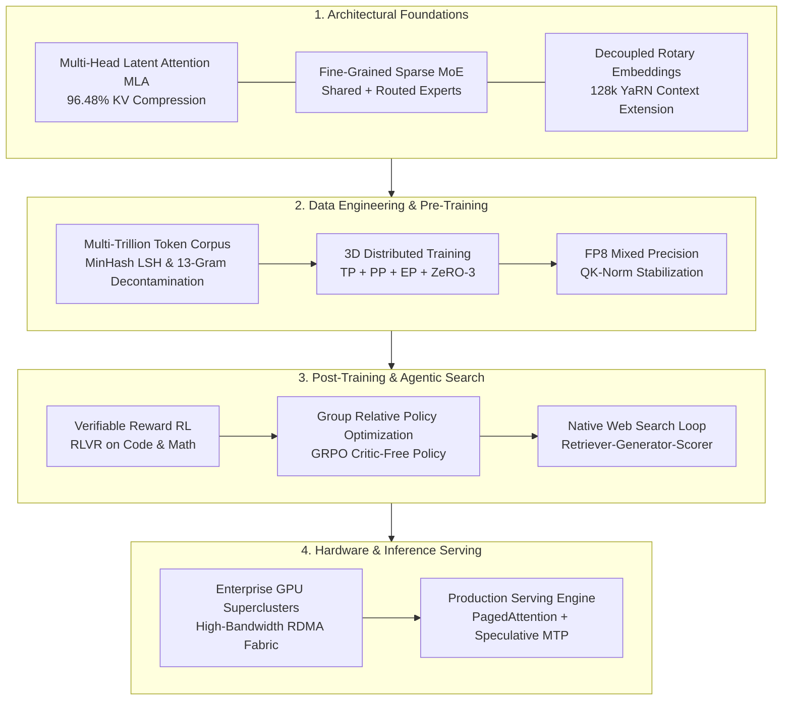

# Frontier LLM Engineering Blueprint: Building From Scratch
**Production-Audited Specification, Mathematical Reconciliations, 9-Stage Engineering Lifecycle, PyTorch Implementations, and Compute Budgeting**

[](https://opensource.org/licenses/MIT)
[](https://www.python.org/)
[](https://pytorch.org/)

This repository contains the verified, production-audited engineering specification and implementation blueprint for building, training, aligning, and deploying frontier-grade Large Language Models (LLMs) from scratch.

---

## 📄 Primary Specification Document

The exhaustive, mathematically reconciled engineering report is located at:
👉 **[`RESEARCH_REPORT_FRONTIER_LLM_FROM_SCRATCH.md`](./RESEARCH_REPORT_FRONTIER_LLM_FROM_SCRATCH.md)**

---

## 📌 Repository Contents

```
.
├── README.md                                    # Project overview and navigation
├── .gitignore                                   # Standard development ignore rules
└── RESEARCH_REPORT_FRONTIER_LLM_FROM_SCRATCH.md # Complete 800+ line engineering specification
```

---

## 🔬 Core Architectural Foundations



1. **Multi-Head Latent Attention (MLA)**:
   - Low-rank joint Key-Value compression into latent vector ($d_c = 512$) with decoupled Rotary Position Embedding ($d_r = 64$).
   - Reduces KV-cache memory consumption by **$96.484\%$** (shrinking from $16,384$ floats/token down to $576$ floats/token).
   - At batch size 16, context length 128,000, and 64 layers under BF16, standard MHA requires **$4.295\text{ TB}$**, whereas MLA requires only **$150.995\text{ GB}$**.

2. **Fine-Grained Sparse Mixture-of-Experts (MoE)**:
   - Segments Feed-Forward Networks into 64 fine-grained routed experts and 2 dedicated shared experts.
   - Dynamic momentum-driven load-balancing router bias updates ($b_i$) to prevent expert starvation without adding conflicting loss terms.

3. **Group Relative Policy Optimization (GRPO)**:
   - Completely eliminates the separate value/critic network, saving $\approx 50\%$ GPU memory during RL training.
   - Samples groups of $G=8$ rollouts per prompt and normalizes advantages strictly within the group, with automated zero-variance safeguards.

4. **Native Agentic Search & Tool Security**:
   - Internalized search triggering via `<|search_query|>` tokens.
   - Prompt-injection sanitization on untrusted web inputs and lexical citation verification ($\ge 40\%$ overlap requirement).

---

## 📊 Parameter Configuration Derivations

| Dimension | Configuration A (Audited Reference) | Configuration B (Calibrated Baseline) |
| :--- | :--- | :--- |
| **Layers ($L$)** | 64 | 64 (3 dense + 61 MoE) |
| **Hidden Dimension ($d_{\text{model}}$)** | 5,120 | 5,120 |
| **Expert FFN Dimension ($d_{\text{ffn}}$)** | 2,816 | 2,048 |
| **Total Experts Per Layer** | 64 routed + 2 shared = 66 | 64 routed + 2 shared = 66 |
| **Active Experts Per Token** | 6 routed + 2 shared = 8 | 6 routed + 2 shared = 8 |
| **Single Expert Parameter Count** | $3 \times 5120 \times 2816 = 43.25\text{M}$ | $3 \times 5120 \times 2048 = 31.46\text{M}$ |
| **Attention Parameters (All Layers)** | 7.44 Billion | 7.44 Billion |
| **Embedding Parameters** | 0.655 Billion | 0.655 Billion |
| **TOTAL SYSTEM PARAMETERS** | **190.8 Billion** | **138.4 Billion** |
| **ACTIVE PARAMETERS / TOKEN** | **30.2 Billion** | **21.9 Billion** |

---

## 🛠️ The Nine-Stage Engineering Lifecycle

1. **Stage 01: Empirical Scaling Laws**: Pilot runs ($100\text{M}\text{--}3\text{B}$), FLOPs corrected beyond $6ND$ for long-context attention ($+18\%$) and all-to-all communication ($+12\%\text{--}15\%$).
2. **Stage 02: Data Governance & Decontamination**: MinHash LSH (Jaccard $>0.8$), SemDeDup (cosine $>0.92$), and 13-gram exact match benchmark decontamination.
3. **Stage 03: Pre-Training Recipe**: Warmup-Stable-Decay (WSD) schedule, global batch size scaling ($3,072 \to 15,360$), AdamW, and FP8 (E4M3/E5M2) execution with FP32 master weights.
4. **Stage 04: Distributed Fault Tolerance**: Megatron-Core MoE with Context Parallelism (CP), Expert Parallelism (EP), grouped GEMMs, asynchronous NVMe checkpointing ($<30\text{s}$), and automated straggler eviction.
5. **Stage 05: Targeted Mid-Training**: $500\text{B}$ tokens of curated STEM, code syntax trees, and synthetic CoT, followed by YaRN context extension ($8\text{k} \to 32\text{k} \to 128\text{k}$).
6. **Stage 06: Full Reasoning RL (RLVR + GRPO)**: Online rollout engine, Docker execution sandboxes, and SymPy verifiers inducing emergent `<start_thinking>` traces.
7. **Stage 07: Native Agentic Tool-Use RL**: Rewarding environment state transitions, prompt injection sanitization, and citation fidelity verification.
8. **Stage 08: Contamination-Free Evaluation**: Private, unreleased test suites across 9 distinct axes (reasoning, coding, agentic workflows, calibration, safety).
9. **Stage 09: Production Serving & SLOs**: Prefill/Decode disaggregation, continuous batching with PagedAttention, speculative Multi-Token Prediction (MTP) decoding ($P_{95}\text{ TTFT} \le 300\text{ms}$, $P_{95}\text{ TPOT} \le 20\text{ms}$).

---

## 💻 PyTorch Implementations Included

The reference specification contains production-grade PyTorch code:
* **`MultiHeadLatentAttention`**: Position-aware `past_len` causal masking for prompt prefill and multi-token cached decode, decoupled RoPE offsets, and QK-Norm stabilization.
* **`FineGrainedSparseMoELayer`**: Momentum-driven dynamic router bias updates ($b_i$) and decoupled expert selection from routing weights.
* **`GRPOTrainer`**: Online rollout generation, verifiable reward computation, zero-variance reward safeguards, and clipped surrogate loss.
* **`SecureSearchToolAgent`**: JSON-schema validation, delimiter sanitization, and citation overlap verification.

---

## ⚖️ License

This project is licensed under the MIT License - see the LICENSE file for details.
