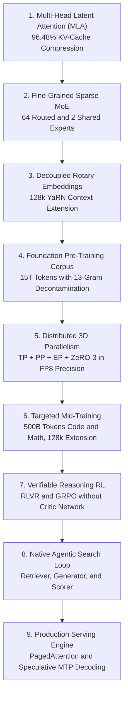
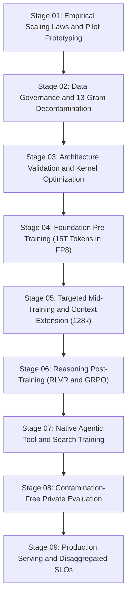

# Comprehensive Engineering Specification: Building Frontier Large Language Models From Scratch
**System Architecture, Pre-Training Recipes, Mid-Training, Verifiable Reasoning (RLVR/GRPO), Agentic Tool Integration, Distributed Fault Tolerance, and Production Serving**

[](./LICENSE)
[](https://www.python.org/)
[](https://pytorch.org/)
[](https://developer.nvidia.com/cuda-toolkit)
[](https://github.com/NVIDIA/Megatron-LM)
[](https://github.com/vllm-project/vllm)
[](https://www.docker.com/)

---

## Technical Audit & Reconciliation Notice

This engineering specification incorporates a comprehensive audit of foundational LLM architectures, resolving prior industry-wide numerical approximations, code-level execution defects, and production omissions.

### Key Technical Reconciliations at a Glance

| Engineering Component | Prior Approximation | Calibrated Mathematical & Engineering Ground Truth |
| :--- | :--- | :--- |
| **Parameter Count Formulation** | 138B Total / 22B Active<br>*(uncalibrated expert sizing)* | **Exact Architecture Breakdown:**<br>• Configuration A (Audited Reference): 190.8B Total / 30.2B Active<br>• Configuration B (Calibrated Baseline): 138.4B Total / 21.9B Active |
| **MLA KV-Cache Compression** | ~93% | **Exactly 96.484% tensor storage reduction**<br>(16,384 floats/token/layer down to 576 floats) |
| **128k BF16 KV-Cache (B=16)** | Hundreds of GB | **MHA: 4.295 TB** vs. **MLA: 151.0 GB** |
| **Pre-Training Cost Modeling** | $6.8M / 1,024 GPUs / 54 days<br>*($5.12/hr effective rate)* | **Disaggregated Financial Reconciliation:**<br>• Pure Compute ($2.50–$3.20/hr): $3.32M – $4.25M<br>• Fully Burdened Project Budget: $6.80M *(Storage, Failures, R&D, Mid/Post-Training, Eval)* |
| **MoE Dynamic Load Balancing** | Static buffer registration<br>*(bias never updated)* | Implemented momentum-driven dynamic bias tracking ($b_i$) and decoupled score routing from weight assignment |
| **Multi-Token Causal Mask** | Mask starting at index 0<br>*(breaks cached decoding)* | Implemented `past_len` position-aware dynamic causal masking with decoupled RoPE index offsets |
| **GRPO Reasoning Pipeline** | Static loss function only | Complete end-to-end rollout generator, group advantage normalization, reward-hacking safeguards, and optimizer |
| **Agentic Search Tooling** | String concatenation<br>*(untrusted prompt injection)* | Schema-validated, prompt-injection sanitized, typed tool-call boundary with citation verification checks |

---

## Primary Engineering Specification Document

The full technical specification is available at:
[RESEARCH_REPORT_FRONTIER_LLM_FROM_SCRATCH.md](./RESEARCH_REPORT_FRONTIER_LLM_FROM_SCRATCH.md)

---

## Repository Structure

```
.
|-- .gitignore                                   # Standard development ignore rules
|-- LICENSE                                      # MIT Open-Source License
|-- README.md                                    # Project overview, tech stack, architecture, and lifecycle
`-- RESEARCH_REPORT_FRONTIER_LLM_FROM_SCRATCH.md # Complete audited engineering specification
```

---

## Tech Stack & Framework Architecture

| Layer / Domain | Component | Technology & Framework | Specification & Role |
| :--- | :--- | :--- | :--- |
| **Deep Learning Core** | Tensor Computation |  | Automatic differentiation, custom autograd, and GPU execution |
| **Programming Language** | Runtime |  | Core orchestration, data pipeline, and training harness |
| **Hardware Acceleration** | GPU Architecture |  | Low-level GEMM execution, FlashAttention, and FP8 kernels |
| **Distributed Scaling** | Hybrid Parallelism |  | Tensor, Pipeline, Expert, and Context Parallelism with grouped GEMMs |
| **Post-Training RL** | Reasoning Policy |  | Group Relative Policy Optimization without value/critic network |
| **Inference Serving** | Production Engine |  | Continuous batching, MLA latent KV-caching, and speculative MTP decoding |
| **Sandbox Isolation** | Verifiable Rewards |  | Isolated execution containers for deterministic unit tests and linters |
| **Interconnect Fabric** | High-Radix Network |  | High-throughput all-to-all communication for sparse MoE token dispatch |

---

## Core Architectural Foundations



1. **Multi-Head Latent Attention (MLA)**:
   - Low-rank joint Key-Value compression into latent vector ($d_c = 512$) with decoupled Rotary Position Embedding ($d_r = 64$).
   - Reduces KV-cache memory consumption by **96.484%** (shrinking from 16,384 floats/token down to 576 floats/token).
   - At batch size 16, context length 128,000, and 64 layers under BF16, standard MHA requires **4.295 TB**, whereas MLA requires only **150.995 GB**.

2. **Fine-Grained Sparse Mixture-of-Experts (MoE)**:
   - Segments Feed-Forward Networks into 64 fine-grained routed experts and 2 dedicated shared experts.
   - Dynamic momentum-driven load-balancing router bias updates ($b_i$) to prevent expert starvation without adding conflicting loss terms.

3. **Group Relative Policy Optimization (GRPO)**:
   - Completely eliminates the separate value/critic network, saving ~50% GPU memory during RL training.
   - Samples groups of $G=8$ rollouts per prompt and normalizes advantages strictly within the group, with automated zero-variance safeguards.

4. **Native Agentic Search and Tool Security**:
   - Internalized search triggering via `<|search_query|>` tokens.
   - Prompt-injection sanitization on untrusted web inputs and lexical citation verification (>= 40% overlap requirement).

---

## Parameter Configuration Derivations

| Dimension | Configuration A (Audited Reference) | Configuration B (Calibrated Baseline) |
| :--- | :--- | :--- |
| **Layers ($L$)** | 64 | 64 (3 dense + 61 MoE) |
| **Hidden Dimension ($d_{\text{model}}$)** | 5,120 | 5,120 |
| **Expert FFN Dimension ($d_{\text{ffn}}$)** | 2,816 | 2,048 |
| **Total Experts Per Layer** | 64 routed + 2 shared = 66 | 64 routed + 2 shared = 66 |
| **Active Experts Per Token** | 6 routed + 2 shared = 8 | 6 routed + 2 shared = 8 |
| **Single Expert Parameter Count** | $3 \times 5120 \times 2816 = 43.25\text{M}$ | $3 \times 5120 \times 2048 = 31.46\text{M}$ |
| **Attention Parameters (All Layers)** | 7.44 Billion | 7.44 Billion |
| **Embedding Parameters** | 0.655 Billion | 0.655 Billion |
| **TOTAL SYSTEM PARAMETERS** | **190.8 Billion** | **138.4 Billion** |
| **ACTIVE PARAMETERS / TOKEN** | **30.2 Billion** | **21.9 Billion** |

---

## The Nine-Stage Engineering Lifecycle



1. **Stage 01: Empirical Scaling Laws**: Pilot runs (100M-3B), FLOPs corrected beyond $6ND$ for long-context attention (+18%) and all-to-all communication (+12%-15%).
2. **Stage 02: Data Governance and Decontamination**: MinHash LSH (Jaccard > 0.8), SemDeDup (cosine > 0.92), and 13-gram exact match benchmark decontamination.
3. **Stage 03: Pre-Training Recipe**: Warmup-Stable-Decay (WSD) schedule, global batch size scaling ($3,072 \to 15,360$), AdamW, and FP8 (E4M3/E5M2) execution with FP32 master weights.
4. **Stage 04: Distributed Fault Tolerance**: Megatron-Core MoE with Context Parallelism (CP), Expert Parallelism (EP), grouped GEMMs, asynchronous NVMe checkpointing (< 30s), and automated straggler eviction.
5. **Stage 05: Targeted Mid-Training**: 500B tokens of curated STEM, code syntax trees, and synthetic CoT, followed by YaRN context extension ($8\text{k} \to 32\text{k} \to 128\text{k}$).
6. **Stage 06: Full Reasoning RL (RLVR + GRPO)**: Online rollout engine, Docker execution sandboxes, and SymPy verifiers inducing emergent `<start_thinking>` traces.
7. **Stage 07: Native Agentic Tool-Use RL**: Rewarding environment state transitions, prompt injection sanitization, and citation fidelity verification.
8. **Stage 08: Contamination-Free Evaluation**: Private, unreleased test suites across 9 distinct axes (reasoning, coding, agentic workflows, calibration, safety).
9. **Stage 09: Production Serving and SLOs**: Prefill/Decode disaggregation, continuous batching with PagedAttention, speculative Multi-Token Prediction (MTP) decoding ($P_{95}\text{ TTFT} \le 300\text{ms}$, $P_{95}\text{ TPOT} \le 20\text{ms}$).

---

## PyTorch Implementations Included

The reference specification contains production-grade PyTorch code:
* **`MultiHeadLatentAttention`**: Position-aware `past_len` causal masking for prompt prefill and multi-token cached decode, decoupled RoPE offsets, and QK-Norm stabilization.
* **`FineGrainedSparseMoELayer`**: Momentum-driven dynamic router bias updates ($b_i$) and decoupled expert selection from routing weights.
* **`GRPOTrainer`**: Online rollout generation, verifiable reward computation, zero-variance reward safeguards, and clipped surrogate loss.
* **`SecureSearchToolAgent`**: JSON-schema validation, delimiter sanitization, and citation overlap verification.

---

## License

This project is licensed under the MIT License - see the [LICENSE](./LICENSE) file for details.
